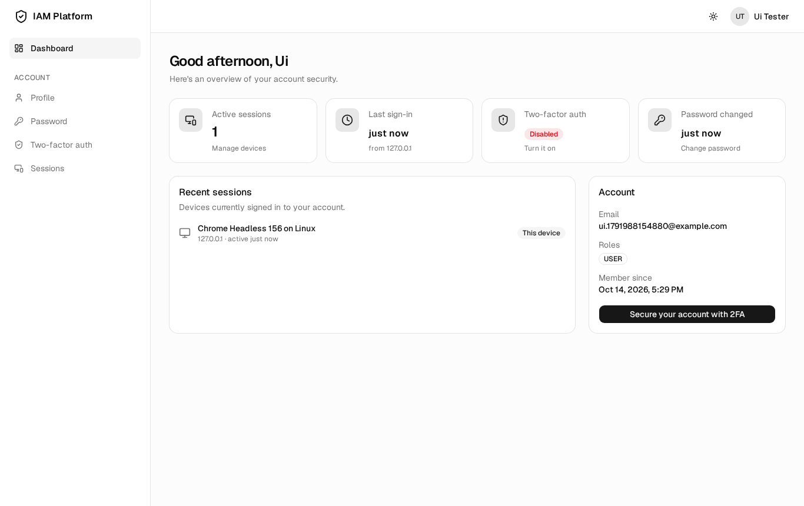
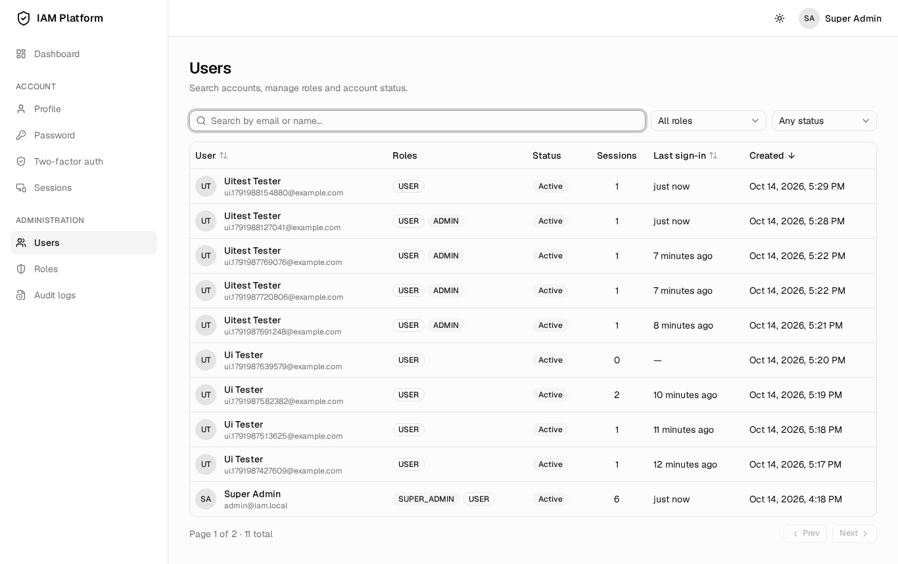
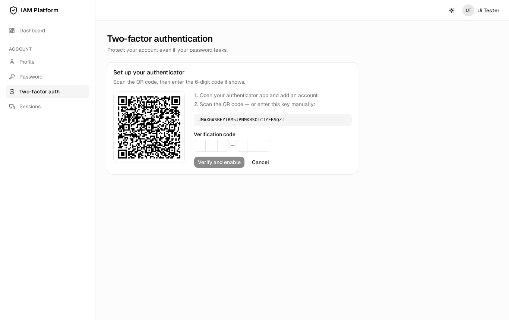
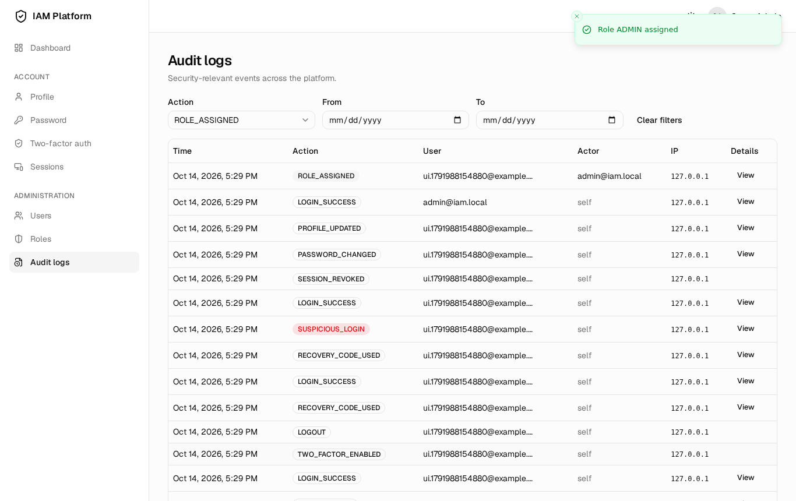
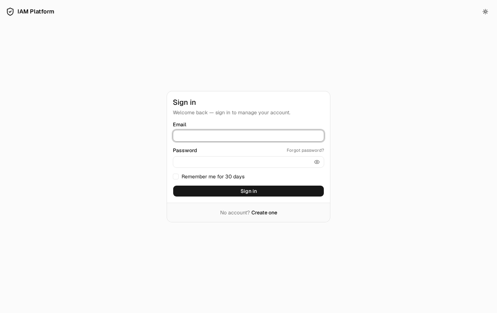
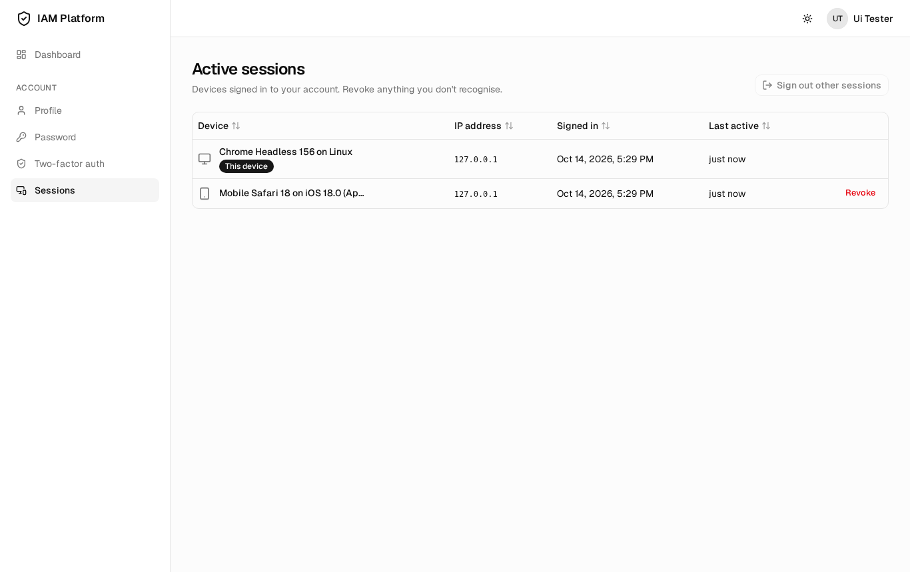
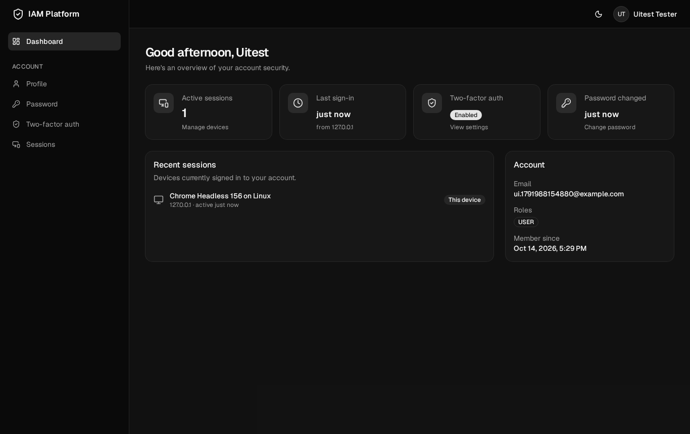
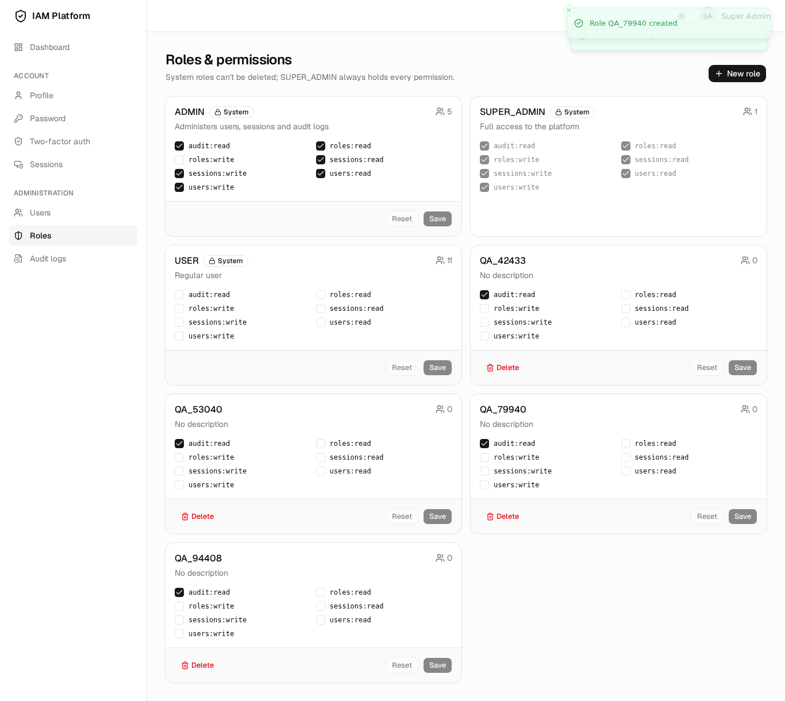
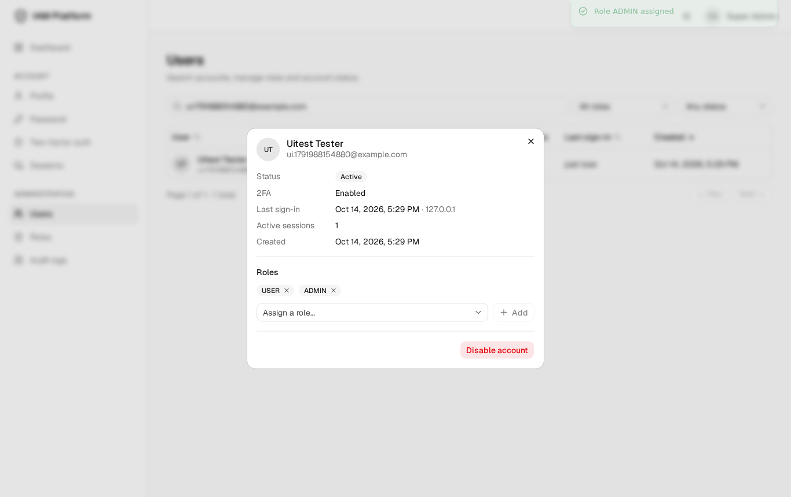
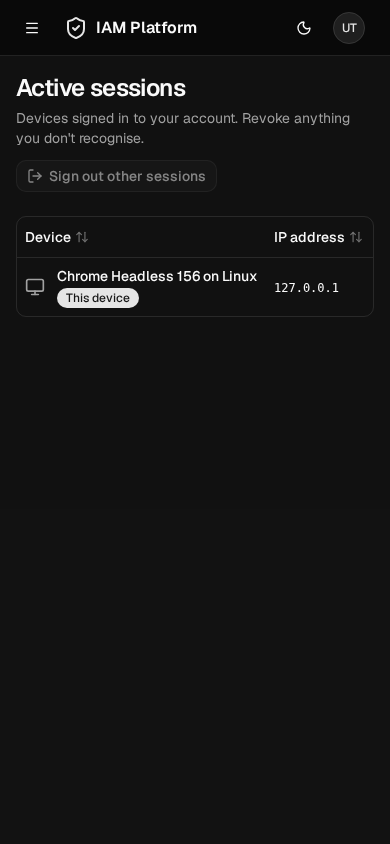

# IAM Platform

An enterprise-style **Identity & Access Management** platform: a NestJS API and a React SPA covering the full account lifecycle. That means registration with email verification, JWT sessions with refresh-token rotation, TOTP two-factor authentication, brute-force protection, RBAC with granular permissions, session management and a security audit trail.

| Dashboard                                    | Admin: users                                     |
| -------------------------------------------- | ------------------------------------------------ |
|  |  |
| **2FA setup**                                | **Audit logs**                                   |
|  |    |

<details>
<summary>More screenshots</summary>

|                                                        |                                                 |
| ------------------------------------------------------ | ----------------------------------------------- |
|                  |       |
|       |             |
|  |  |

</details>

---

## Features

**Authentication**

- Email + password sign-up. Passwords are hashed with bcrypt (cost 12) and must score ≥ 3 on zxcvbn. The last 5 passwords can't be reused.
- Email verification and password reset use single-use, hashed, expiring tokens, delivered by a BullMQ mail queue with Handlebars templates.
- Short-lived access JWTs (15 min) plus rotating refresh tokens (7 days, or 30 with "remember me") in an `HttpOnly` cookie.
- TOTP 2FA works with Google Authenticator, Microsoft Authenticator and other TOTP apps. Setup uses a QR code, users get 10 one-time recovery codes, and used codes can't be replayed.
- Email change requires re-verifying the new address.

**Security hardening**

- **Refresh token rotation with reuse detection.** Replaying a rotated token revokes the whole token family and every access token in it.
- Only SHA-256 hashes of refresh and verification tokens are stored, and TOTP secrets are encrypted at rest (AES-256-GCM).
- Account lockout after 5 failed attempts (auto-unlock after 15 min), plus exponential back-off per email + IP.
- Logins from a new IP or device are flagged, audited and trigger an email alert.
- Redis-backed rate limiting (global plus stricter per-route limits), Helmet, a strict CORS allow-list, and a double-submit CSRF token for cookie-authenticated endpoints.
- All errors are returned as **RFC 7807** `application/problem+json` with machine-readable `code`s.
- Responses never reveal whether an account exists (register, forgot password, resend verification, login timing).

**Authorization and administration**

- System roles `SUPER_ADMIN`, `ADMIN` and `USER`, plus custom roles with granular permissions (`users:read`, `roles:write`, …).
- Global `RolesGuard` and `PermissionsGuard`. Roles and permissions are read from the database on every request, never trusted from the token or the client.
- Admin console: user search and filters, role assignment, enable/disable, unlock, role and permission editor, audit log explorer, and all active sessions.
- Users can list their own sessions, revoke one, or sign out everywhere else.

**Frontend**

- The access token is kept **in memory only**, and a silent refresh via the cookie restores the session on reload.
- A single-flight refresh interceptor: concurrent 401s share one refresh request, and each original request is retried exactly once.
- Route guards (`PrivateRoute`, `GuestRoute`, `RoleGuard`), lazy-loaded routes, and optimistic session revocation.
- Dark/light/system theme, a responsive layout with a mobile drawer, toasts, skeletons and accessible forms.

---

## Architecture

```
┌──────────────────────────┐   /api (Vite proxy in dev)   ┌───────────────────────────────┐
│  React SPA (apps/frontend)│ ───────────────────────────▶ │  NestJS API (apps/backend)    │
│  TanStack Query · Zustand │   Bearer access token        │  Passport JWT · Guards        │
│  React Router · shadcn/ui │   HttpOnly refresh cookie    │  Prisma · BullMQ · Pino       │
└──────────────────────────┘   + X-CSRF-Token             └──────┬──────────┬──────────┬──┘
                                                                  │          │          │
                                                           ┌──────▼───┐ ┌────▼────┐ ┌───▼─────┐
                                                           │PostgreSQL│ │  Redis  │ │  SMTP   │
                                                           │  (data)  │ │ limits, │ │(Mailpit │
                                                           └──────────┘ │ queue,  │ │ in dev) │
                                                                        │ revoke  │ └─────────┘
                                                                        └─────────┘
```

### Token lifecycle

```
login ──▶ access JWT (15 min, in memory)  +  refresh JWT (cookie; only its SHA-256 hash in DB)
                 │                                   │
        API call │ 401 expired                       │ POST /auth/refresh  (cookie + X-CSRF-Token)
                 ▼                                   ▼
        single-flight refresh ─────────▶ conditional UPDATE revokes the old token and inserts
                                         its successor in the same family (one transaction)
                                         │
                                         └─ old token presented again? → reuse detected →
                                            revoke the whole family + its access tokens (Redis)
```

Each access token carries a `sid` (session/family id). Revoking a session, logging out, changing the password, or detected reuse writes a short-lived Redis marker, so access tokens die immediately instead of after 15 minutes.

### Repository layout

```
apps/
├── backend/                 NestJS API
│   ├── prisma/              schema, migrations, seed
│   ├── src/
│   │   ├── auth/            register, login, refresh/logout, lockout & back-off, JWT strategy, CSRF guard
│   │   ├── two-factor/      TOTP enable/confirm/disable/verify, recovery codes
│   │   ├── password/        change/forgot/reset, zxcvbn policy, password history
│   │   ├── tokens/          token issuing/rotation/revocation, auth cookies
│   │   ├── users/  sessions/  admin/  rbac/  audit/  mail/  health/
│   │   ├── config/ database/ redis/ logger/   infrastructure modules
│   │   └── common/          decorators, guards, RFC 7807 filter, pagination
│   └── test/                e2e suite (supertest)
└── frontend/                React SPA
    └── src/
        ├── app/             providers, router, layouts
        ├── features/        auth · dashboard · profile · sessions · admin
        ├── shared/          api (client, refresh, interceptors) · components · hooks · stores · types
        └── pages/           route-level components
```

---

## Getting started

**Prerequisites:** Node.js ≥ 22 (see `.nvmrc`) and Docker with Compose.

```bash
npm install                                          # installs both workspaces + git hooks
cp apps/backend/.env.example apps/backend/.env       # then replace the secrets (see below)
cp apps/frontend/.env.example apps/frontend/.env
npm run setup                                        # starts postgres/redis/mailpit, migrates, seeds
npm run dev                                          # API on :3000, SPA on :5173
```

Generate real secrets for `apps/backend/.env`:

```bash
openssl rand -base64 48   # JWT_ACCESS_SECRET, JWT_REFRESH_SECRET, JWT_2FA_SECRET (one each)
openssl rand -base64 32   # TWO_FACTOR_ENC_KEY
```

| URL                              | What                                             |
| -------------------------------- | ------------------------------------------------ |
| http://localhost:5173            | Web app                                          |
| http://localhost:3000/api/docs   | Swagger / OpenAPI                                |
| http://localhost:3000/api/health | Health check (PostgreSQL + Redis)                |
| http://localhost:8025            | Mailpit, which catches every email the API sends |

**Seeded super admin:** `admin@iam.local` / `Admin-Passw0rd!2026`. Set `SEED_ADMIN_*` in `.env` to change it, and change it anywhere that isn't local.

### Scripts (repository root)

| Command                                      | Description                                |
| -------------------------------------------- | ------------------------------------------ |
| `npm run dev`                                | Run API and SPA together                   |
| `npm run setup`                              | `docker compose up` + migrations + seed    |
| `npm run lint` / `npm run typecheck`         | Lint / type-check both apps                |
| `npm test`                                   | Unit tests (backend Jest, frontend Vitest) |
| `npm run db:test:up` then `npm run test:e2e` | Backend e2e against an isolated database   |
| `npm run build`                              | Production builds                          |

### Configuration

Every variable is documented in [`apps/backend/.env.example`](apps/backend/.env.example), [`apps/frontend/.env.example`](apps/frontend/.env.example) and [`.env.example`](.env.example) (the Docker Compose overrides). The backend validates its environment with Joi at startup and refuses to boot if a secret is missing or shorter than required. Security policy is configurable: bcrypt cost, password history depth, lockout threshold and duration, token lifetimes, rate limits, and whether a password change revokes other sessions.

---

## Testing

| Layer             | Tooling                                                                            | Covers                                                                                                                                                                                                                  |
| ----------------- | ---------------------------------------------------------------------------------- | ----------------------------------------------------------------------------------------------------------------------------------------------------------------------------------------------------------------------- |
| Backend unit (40) | Jest + jest-mock-extended                                                          | `AuthService`, `TokenService` (rotation, reuse, race), `UsersService`, `TwoFactorService`, password policy                                                                                                              |
| Backend e2e (9)   | `@nestjs/testing` + supertest, isolated Postgres/Redis (`docker-compose.test.yml`) | register → verify → login → refresh → reuse detection → logout, session revocation, RBAC, problem details                                                                                                               |
| Frontend (30)     | Vitest + Testing Library + MSW                                                     | single-flight refresh, interceptors (concurrent 401s, retry once, failed refresh → logout + redirect, no refresh on auth endpoints), `useAuth`/`usePermissions`, `RoleGuard`, route guards, expired-session integration |

GitHub Actions (`.github/workflows/ci.yml`) runs lint, type-check, unit tests, e2e tests (with Postgres and Redis service containers) and builds for both apps.

---

## API overview

All routes are prefixed with `/api`. Full request/response schemas are in Swagger.

| Area     | Endpoints                                                                                                                                                                                                                                                                                      |
| -------- | ---------------------------------------------------------------------------------------------------------------------------------------------------------------------------------------------------------------------------------------------------------------------------------------------- |
| Auth     | `POST /auth/register` · `/verify-email` · `/resend-verification` · `/login` · `/refresh` · `/logout` · `/logout-all`                                                                                                                                                                           |
| Password | `POST /auth/change-password` · `/forgot-password` · `/reset-password`                                                                                                                                                                                                                          |
| 2FA      | `POST /auth/2fa/enable` · `/confirm` · `/disable` · `/verify`                                                                                                                                                                                                                                  |
| Profile  | `GET /users/me` · `PATCH /users/me`                                                                                                                                                                                                                                                            |
| Sessions | `GET /sessions` · `DELETE /sessions/:id` · `DELETE /sessions`                                                                                                                                                                                                                                  |
| Admin    | `GET /admin/users` · `GET /admin/users/:id` · `PATCH /admin/users/:id/role` · `PATCH /admin/users/:id/status` · `GET/POST /admin/roles` · `PATCH /admin/roles/:id/permissions` · `DELETE /admin/roles/:id` · `GET /admin/permissions` · `GET /admin/audit-logs` · `GET/DELETE /admin/sessions` |
| Ops      | `GET /health`                                                                                                                                                                                                                                                                                  |

---

## Design notes

- **HS256 with separate secrets** for access, refresh and 2FA-challenge tokens. Verification pins the algorithm, issuer and audience, and each token type has its own audience, so one type can't be used as another.
- **Refresh tokens are signed JWTs, but only their hash is stored.** The signature check rejects forged tokens before any database lookup, and a database leak doesn't expose usable tokens.
- **Cookies are `SameSite=Strict`, scoped to `/api`, and `Secure` in production.** The double-submit CSRF header adds defence in depth for the two cookie-authenticated endpoints. In development, the Vite proxy keeps the SPA and API same-origin.
- **Authorization is always resolved server-side.** Access tokens carry identity only, and role changes take effect on the next request.
- **Pinned majors:** NestJS 11 (a dependency, `@nest-lab/throttler-storage-redis`, doesn't support 12 yet) and Prisma 6.
